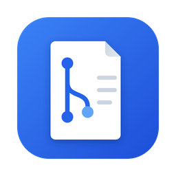
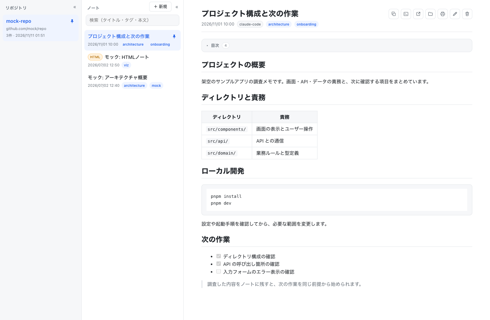
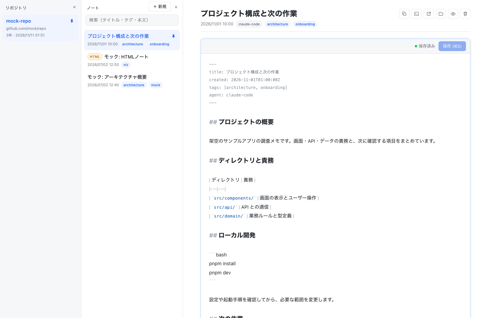

<p align="center">
  
</p>

<h1 align="center">repo-notes</h1>

<p align="center">AI エージェントの調査メモを、リポジトリごとに読む・探す・編集するデスクトップアプリ。</p>

<p align="center">
  <a href="docs/getting-started.md">導入ガイド</a> ·
  <a href="docs/development.md">開発ガイド</a> ·
  <a href="skill/SKILL.md">エージェント用スキル</a>
</p>



Claude Code / Codex に調査や実装を任せたあと、その内容を読み返すためのノートアプリです。エージェントがスキルで残したメモを、Git リポジトリごとにまとめて閲覧できます。

ノートはローカルの `~/.repo-notes/` に保存します。プロジェクトの Git リポジトリをメモで増やさず、複数のワークツリーから同じリポジトリのメモを共有できます。

## 主な機能

- **リポジトリごとの整理** — リポジトリ・ノート・本文の 3 ペインで、対象を切り替えながら閲覧。
- **検索とピン留め** — タイトル・タグ・本文から検索し、よく使うリポジトリやノートを固定。
- **Markdown と図の表示** — コード、表、チェックリスト、Mermaid、画像・SVG、自己完結の静的 HTML に対応。
- **ノートの作成・編集** — Markdown をアプリ内で編集。別の書き込みと競合した場合は、保存を拒否して下書きを保持。
- **作業への引き継ぎ** — ノートのパスや Claude 向けの依頼文をコピーし、外部エディタ・Finder で開く操作も可能。
- **印刷と PDF 保存** — Markdown ノートの本文を出力。

## エージェントとノートの利用

1. プロジェクトのリポジトリで、エージェントに「構成を調べて、repo-notes にメモして」と依頼。
2. アプリでリポジトリとノートを選び、調査内容を確認。
3. 必要な補足を編集し、次の作業で「前回のメモを読んで進めて」と依頼。

アプリとエージェントが同じローカルのノートを読み書きします。導入方法は[導入ガイド](docs/getting-started.md)を参照してください。

## Markdown の編集画面



編集ボタンで本文を開き、保存ボタンまたは `⌘S` で保存できます。HTML ノートは閲覧専用です。

画面例はブラウザ開発モードで撮影した架空のサンプルです。[サンプル本文と撮影条件](docs/screenshots/README.md)もリポジトリに含めています。

## クイックスタート

macOS でソースから起動する手順です。Node.js 24 / pnpm 11、Rust、Xcode Command Line Tools が必要です。

```bash
mise install
pnpm install
pnpm tauri dev
```

エージェントからノートを残すには、続けて `make install-skill` で Claude Code / Codex 用のスキルを導入します。ビルドや rulesync を使う場合を含む手順は[導入ガイド](docs/getting-started.md)にまとめています。

## ドキュメント

| ドキュメント | 内容 |
|---|---|
| [導入ガイド](docs/getting-started.md) | アプリの起動、スキルの導入、最初のノート |
| [開発ガイド](docs/development.md) | 構成、ビルド、テスト、デバッグ |
| [ノート形式](docs/note-format.md) | repo-key の導出、Markdown / HTML のメタデータ、制限事項 |
| [保存と安全性](docs/storage.md) | 保存先、ファイルアクセス、保存競合、I/O の実行先 |
| [スクリーンショット](docs/screenshots/README.md) | 公開用画像の撮影条件とサンプル本文 |

## ライセンス

repo-notes のコード・ドキュメント・同梱スキルは [MIT License](LICENSE) で公開しています。
依存ライブラリにはそれぞれのライセンスが適用されます。[第三者ライセンスと配布条件](docs/licenses.md)を参照してください。
